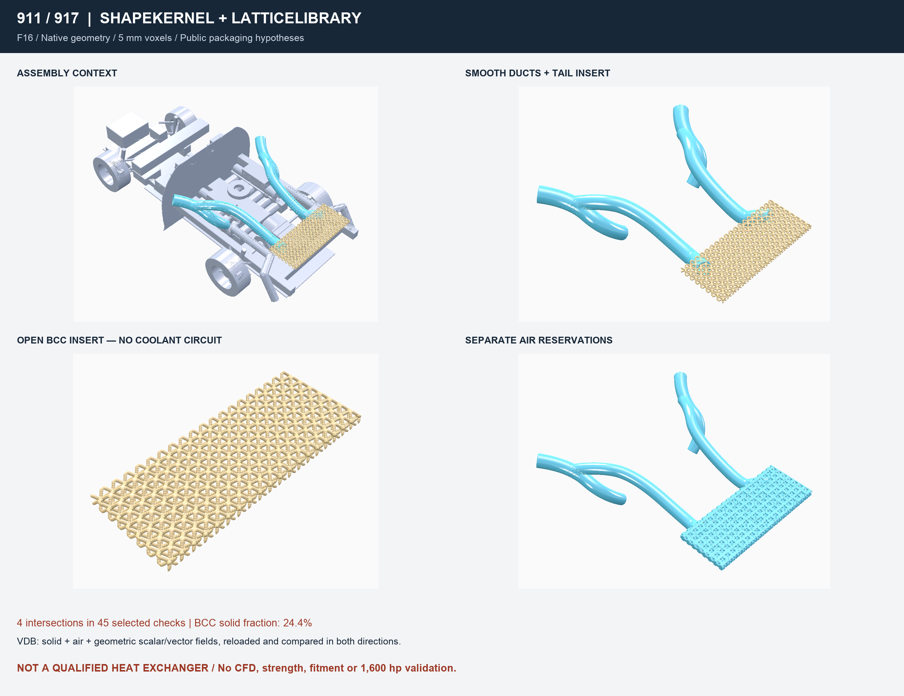

# F16 — installed LEAP libraries in the vehicle study

F16 extends the [F15 packaging assembly](FULL_VEHICLE.md) without modifying its
sources or native receipts. This is an air-path and open-lattice **geometry
study**, not a functional vehicle or a qualified heat exchanger.

## Requirement, implementation and verification

| Requirement | Implementation | Acceptance check |
|---|---|---|
| Use ShapeKernel on the Mac | Four mirrored, hollow, variable-section ducts using `ControlPointSpline`, `Frames` and `BasePipe` | Non-empty separate wall/air STL and VDB exports; intersections with nine declared obstacles |
| Use LatticeLibrary | Deterministic `RegularCellArray`, `BodyCentreLattice`, `ConstantBeamThickness`, clipped inside the F15 tail exchanger reservation | Native solid fraction and geometry VDB roundtrip |
| Exchange fields | Named `solid`, `air`, `solid_sdf_voxel`, `solid_sdf_gradient` in one VDB | Same 5 mm grid; exact voxel equality; all active scalar/vector values compared in both directions |
| Preserve the vehicle context | Read-only import of F15 public component VDBs | F15 report, inputs and exports checked before execution; private scans rejected |
| Preserve evidence | New output/build folders only, SHA-256 inputs and exports | Refuse overwrite, changed dependencies and promoted physical gates |

The lattice is an **open BCC insert study**, not radiator fins or a pressure
boundary. Its 60 mm cells and 15 mm beam diameter are deliberately coarse at
5 mm voxels. No liquid network, collectors, pressure boundary, seal, selected
material or attachment design is supplied. The solid fraction is a geometric
ratio, not a measured mass, stiffness improvement or heat-transfer result.

The smooth quarter-intake paths retain the F15 terminal hypotheses. The
15 mm walls are a numerical study choice, not a selected automotive wall
thickness. Replacing a polyline by a spline changes intermediate clearances;
the new pair checks must be reviewed rather than inheriting F15's outcome.
The old straight firewall, drivetrain, wheels, body and fixed tail remain in
the context. F15 uses a documentary 993 base, not a measured 930 surface.

The final local routing trial moves the two tail terminals 40 mm inboard
(Y = ±430 instead of ±470 mm). These are new hypotheses, not measured ports.

## Local result — 12 October 2026



The Mac generated ten new solid/air exports in the context of 42 unchanged
F15 components. Four trials were retained in local `work/`: r0 found eight
intersections, r1 four, r2 six and r3 four. None is an accepted installation.
The r3 board above is generated from actual native captures, not an artistic
render. Changing the duct routes did not modify or cut the F15 body.

In r3, the nine-obstacle screen finds no intersection with the wheel-motion
reservations, frame corridors, exhaust, transaxle, firewall or tail lip.
It still finds **four intersections**: the left and right tail ducts each
intersect the body and the plenum. Those openings and sealed connections are
unresolved; a contact at the desired joint is not a designed joint. The screen
does not cover duct-to-duct contacts, all engine ancillaries, movement, thermal
growth or an independent clearance margin. No all-clear claim is made.

The open BCC insert has a native solid fraction of **24.40856%** inside its
study zone; 567 cells were considered before clipping. VDB reloading preserved
both solid/air domains exactly and all **393,293 active scalar values and
393,293 active vector values**, compared in both directions. An added-value
negative control was rejected. The fields remain purely geometric.

The existing independent raw-STL inspector retained all triangles in all ten
exports: one connected surface each, consistent winding, positive component
volume, and no boundary edges, non-manifold edges, duplicate or degenerate
triangles. This is a raw mesh screen, not a self-intersection, wall-thickness,
leak, manufacturing or physical validation. The initial inspection environment
lacked SciPy; rerunning in the already-installed `bionic-tools` environment
completed the inspection without installing anything.

Focused checks passed **45 tests, four intentional skips**, including F14/F15
regressions and the F16 native receipt. The initial offline build emitted
35 upstream obsolete-API warnings and zero errors; later incremental builds
had no warnings or errors. Full Mac `make check` ran 3,696 tests and failed
with two failures, 23 errors and 207 skips in the previously observed
SciPy/Python/exact-float paths. It is not reported as green.
Strict documentation checking passed: 841 Markdown files, zero broken links.

**Source revision.** This Mac result was built from the F16 sources of commit
`102ea2d7`. The Linux port on 15 October changed three of the inputs its
receipt hashes: `leap-f16/Program.cs` (the TGA completion wait),
`leap-f16/VehicleLeap.csproj` (the `.so` runtime glob) and
`source/run_leap_f16.py` (`check_native_exit` and `--config`). At the current
revision, `verify_output` on that existing Mac output therefore raises
`Stale input receipt`, and so does the F16 native receipt test pointed at it.
The Mac result can be re-verified only by checking out `102ea2d7`, or by
re-running F16 on the Mac with the current runner into a new output folder.
That re-run, which would also be the first macOS run of the TGA wait and the
`.so` glob, needs the owner's Mac and has not been done.

## Interfaces and load paths still required

Before functional duct or insert design, obtain the actual quarter inlet,
compressor inlet and tail plenum port frames, flange faces, attachment holes,
sealing lands, tolerances and allowed loads. Duct and insert weight, pressure
and vibration loads must reach measured body/plenum attachments; these
interfaces are unknown, not invented in this study. Thermal growth, engine
motion, service removal, water drainage and firewall sealing remain open.

Distance and gradient fields describe the generated geometry only. They are
not fluid velocity, pressure, temperature, a CFD mesh or a solved boundary
condition. The open air domain inside the core is not a complete cooling
circuit. Port continuity, raw mesh quality, resolution convergence, pressure
loss, heat rejection, aerodynamic balance, strength and fatigue require
separate engineering checks. No 1,600 hp capability is established.

## Reproduction on the installed Mac stack

These commands produce a new run with the current sources; they do not
re-verify the 12 October output, which needs the `102ea2d7` sources (see
*Source revision* above). They have not yet been run on macOS at this revision.

```sh
python3 twins/vehicle-911-917/source/run_leap_f16.py \
  --leap-root /Users/maxime/Developer/PicoGK \
  --baseline work/911-917-picogk-f15 \
  --output work/911-917-leap-f16-new

PICOGK_F16_RESULT="$PWD/work/911-917-leap-f16-new" \
  python3 -m unittest discover -s tests -p 'test_911_917_leap_f16.py' -v

# Use an environment with the existing NumPy, Pillow, SciPy and trimesh stack.
python3 twins/vehicle-911-917/source/inspect_leap_f16.py \
  work/911-917-leap-f16-new
```

The runner checks the installed source/runtime hashes against the Mac's
installation receipt, builds offline and reuses the machine-wide native
PicoGK lock. If another native job holds the lock for a minute, it stops;
do not delete another job's lock. A new output name is required on retry.
The sources remain editable C# and JSON; STL/VDB do not constitute editable
STEP history or manufacturing drawings. No private scan is admitted here.

Outputs include ten separate wall/air/core STL and VDB files, the four-field
exchange VDB, five native images, a review board and a hashed JSON receipt.
The board only arranges native captures; it does not invent geometry.

## Linux reproduction — 15 October 2026

The r3 study was regenerated natively on a Linux host (WSL2, Ubuntu 24.04,
OpenGL through Mesa D3D12). It is recorded separately in
[leap-f16-linux-receipt-20261015.json](leap-f16-linux-receipt-20261015.json);
the Mac result and `preview/leap-f16.png` above are unchanged.

- **Inputs.** The F15 context is a Linux regeneration
  (`work/911-917-picogk-f15-linux-20261015`), not the Mac F15 baseline. The
  LEAP root was assembled by `source/prepare_linux_leap_root.py`: PicoGK 2.3.0
  and SkiaSharp 3.119.0 from the NuGet cache, native runtime commit
  `0f26321c18ed878a7820ef769c38fd5d49d39242`, .NET SDK 9.0.318, and the same
  ShapeKernel and LatticeLibrary revisions as above, verified with
  `git rev-parse HEAD` on clean checkouts. Every copied file is hashed into the
  root's `setup/installation.json`, which the runner checks before building.
- **Result.** Run `work/911-917-leap-f16-r3-linux-d` reproduces every metric
  published for the Mac run: solid fraction 24.40856%, 567 cells before
  clipping, 393,293 scalar and 393,293 vector values compared in both
  directions, the negative control rejected, 45 checks and the same four
  intersections (each tail duct against `body_shell` and `tail_plenum`). The
  raw-STL inspector passed all ten exports. Byte equality with the Mac exports
  was **not** checked: the Mac per-file hashes are not in this repository.
- **Repeatability on Linux.** Against the earlier complete attempt `-c`, the
  STL and capture bytes, volumes and check results are identical. Every VDB
  differs only within its first 57 bytes, the header region that holds a
  per-file UUID, so VDB hashes are not expected to repeat between runs.
- **Native exit.** The process segfaults (return code −11) during teardown,
  after PicoGK has logged `Done.`. `check_native_exit` accepts only that exact
  case with `report.json` present; any other exit fails the run, and
  `verify_output` then re-hashes every export. The native program also waits
  until each TGA capture has its full size before hashing it.

```sh
. ~/picogk/env.sh
python3 twins/vehicle-911-917/source/prepare_linux_leap_root.py \
  --output ~/picogk/leap-root-linux-<date>
flock /tmp/porscheparts-heavy.lock ~/picogk/run-capped.sh -m 6G \
  python3 twins/vehicle-911-917/source/run_leap_f16.py \
  --leap-root ~/picogk/leap-root-linux-<date> \
  --baseline work/911-917-picogk-f15-linux-20261015 \
  --output work/911-917-leap-f16-linux-new
```

Run the Python steps in an environment that has NumPy and Pillow; the
inspector also needs trimesh and SciPy. Set `PICOGK_F16_RESULT` to the run
named in the receipt to check the receipt against it. Earlier Linux attempts
(`-r3-linux`, `-b`, `-c`) are retained in local `work/` and are not used as
results. The Linux build reported 35 upstream obsolete-API warnings and zero
errors, as the first Mac build did.

The F16 module passed 16 tests on Linux with `PICOGK_F16_RESULT` set to run
`-d`. A full Linux `make check` in a venv with the CI pins (Python 3.12,
NumPy 2.2.6) passed: 4,011 tests, 226 skips, zero broken links in 1,097
Markdown files. An earlier attempt the same day had one error: an F15 native
preflight subprocess hit its 15 s timeout while other jobs loaded the host.
That test only runs where a local F15 build exists; it passed alone (23 s)
and is skipped on a clean `origin/main` checkout.

## Dependency provenance

The existing installation is reused without copying third-party source into
this repository or downloading new packages. Original Apache-2.0 notices are
retained in that installation. On the Mac, the recorded revision is the
installation's provenance claim, verified by file hashes, not a fresh Git
checkout. On the Linux root it was verified with Git on clean checkouts.

- [ShapeKernel](https://github.com/leap71/LEAP71_ShapeKernel/tree/554bce4791d2676ed00bd6704f6eb010111a7fd3), `554bce4791d2676ed00bd6704f6eb010111a7fd3`.
- [LatticeLibrary](https://github.com/leap71/LEAP71_LatticeLibrary/tree/81c3c7b2064c19e573c38d76ac09bf1cd2f562d5), `81c3c7b2064c19e573c38d76ac09bf1cd2f562d5`.
- PicoGK 2.3.0 / native 26.2, installed .NET 9 SDK. Binary redistribution and
  transitive licence obligations are outside this source-only change.

No chassis lightening, transmission redesign or artificial physical fields
are added by this increment. All previous physical release gates stay closed.
